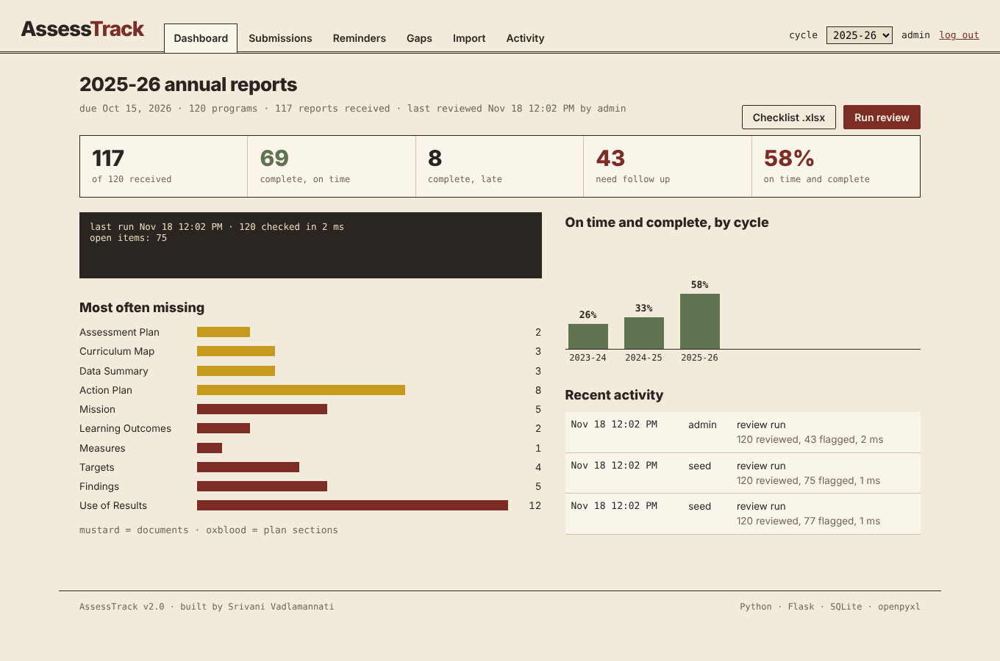
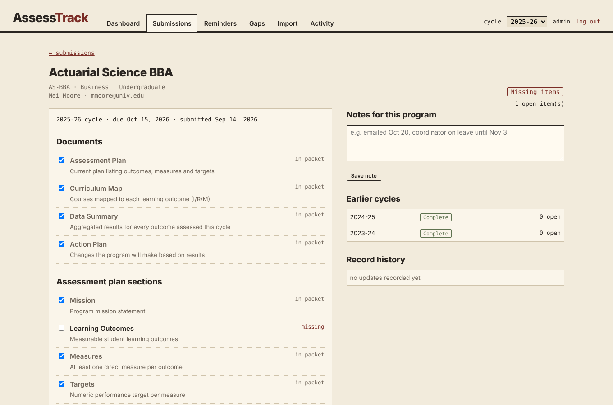

# AssessTrack

A web app for the first pass of the annual program assessment review. It checks every program's report submission for the required documents and assessment plan sections, flags what's missing or late, writes one reminder per coordinator, and keeps a record of every update staff make.

Built with **Python, Flask, SQLite and openpyxl**. Server-rendered pages with a small JSON API behind the interactive parts.





## What it does

| Page | What happens there |
|---|---|
| **Dashboard** | Cycle totals, the **Run review** button, a chart of what's missing most often, the on time/complete trend across cycles |
| **Submissions** | All 120 programs with status and missing items. Filter by college or status, search, sort |
| **Program checklist** | Tick a document or section as received. The record updates, the program is re-reviewed and the change goes in its history |
| **Reminders** | One ready-to-send message per coordinator covering all of their programs. Copy it, or download the whole list as Excel |
| **Gaps** | Missing items by requirement and by college, plus cycle-over-cycle results |
| **Import** | Upload a `.csv` or `.xlsx` export (from the assessment software or a tracking sheet) to create or update submissions |
| **Activity** | Every change and every review run, with who did it |

### How the review decides a status

```
not_submitted   nothing received for the cycle
missing         received, but a required document or plan section is absent
late            everything is there, received after the due date
complete        everything is there, received on time
```

The rules live in `assesstrack/review.py` as a pure function (`classify`) so they're unit tested on their own. `run_review` pulls all items for a cycle in one query and updates every submission in a single batch.

## Run it locally (Mac / Linux)

```bash
git clone https://github.com/SrivaniVadlamannati/assesstrack.git
cd assesstrack
python3 -m venv .venv
source .venv/bin/activate
pip install -r requirements.txt
flask --app assesstrack run --debug
```

Open http://127.0.0.1:5000 and log in with **admin / assess2026**. The database is created and seeded from `data/` on first start.

On Windows use `.venv\Scripts\activate` instead of `source …`.

### Command line

```bash
flask --app assesstrack review                  # review the current cycle, write both workbooks to exports/
flask --app assesstrack review --cycle 2024-25  # a specific cycle
flask --app assesstrack init-db                 # wipe and reseed the database
python -m pytest -q                             # run the tests
```

Set `ASSESSTRACK_ADMIN_PASSWORD` and `SECRET_KEY` as environment variables before the first run to change the defaults.

## API

All routes need a logged-in session cookie. Add `?cycle=<id>` to any route to pick a cycle (default: current).

| Method | Route | |
|---|---|---|
| GET | `/api/cycles` | reporting cycles |
| GET | `/api/requirements` | required documents and plan sections |
| GET | `/api/summary` | totals for a cycle |
| GET | `/api/submissions?status=&college=&q=&sort=` | filtered list with missing items |
| GET | `/api/submissions/<id>` | one submission with checklist, history, earlier cycles |
| PATCH | `/api/submissions/<id>/items/<requirement_id>` | `{"present": true}` marks an item received |
| PUT | `/api/submissions/<id>/notes` | `{"notes": "..."}` |
| POST | `/api/reviews` | run the review, returns counts and timing |
| GET | `/api/reviews` | past runs |
| GET | `/api/reminders` | reminder messages grouped by coordinator |
| GET | `/api/gaps` | missing items by requirement, by college, trend |
| GET | `/api/activity?limit=` | audit log |
| POST | `/api/import` | multipart `file` (.csv or .xlsx) |
| GET | `/api/export/checklist.xlsx` | Summary (with chart), Checklist grid, Open items sheets |
| GET | `/api/export/reminders.xlsx` | reminder list |

Example:

```bash
curl -c jar -d "username=admin&password=assess2026" http://127.0.0.1:5000/login
curl -b jar -X POST http://127.0.0.1:5000/api/reviews -H "Content-Type: application/json" -d '{}'
curl -b jar "http://127.0.0.1:5000/api/submissions?status=missing&college=Business"
```

## Data

`data/` holds the seed data as plain CSV so it's easy to inspect:

| File | Rows | |
|---|---|---|
| `programs.csv` | 120 | degree programs across 7 colleges |
| `coordinators.csv` | 36 | program assessment coordinators |
| `cycles.csv` | 3 | 2023-24, 2024-25, 2025-26 (current) |
| `requirements.csv` | 10 | 4 documents + 6 plan sections |
| `submissions.csv` | 360 | one per program per cycle |
| `submission_items.csv` | ~3,400 | which items each received report included |

The data is **synthetic**. `scripts/generate_data.py` builds it with a fixed random seed, so `python scripts/generate_data.py` recreates the same files. Program names follow a typical university catalog; people and emails are made up.

## Project layout

```
assesstrack/
  __init__.py      app factory + CLI commands
  schema.sql       tables
  db.py            connection, seeding, activity log
  review.py        review rules and the batch review
  services.py      queries shared by pages, API and CLI
  excel.py         openpyxl exports and .xlsx import
  api.py           JSON API
  views.py         pages
  auth.py          login
  templates/  static/
data/              seed CSVs
scripts/           data generator
tests/             pytest
```
